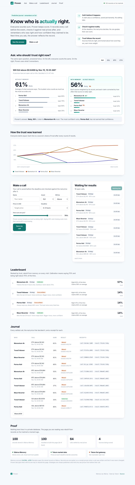

<p align="center">
  
</p>
<h1 align="center">Proven</h1>
<p align="center"><b>Know who is actually right.</b><br/>A calibrated prediction journal for crypto price calls. Every call is remembered on Sui mainnet, checked against real prices, and used to learn who deserves your trust.</p>
<p align="center">
  <a href="https://proven-ten.vercel.app"><b>Open the live app</b></a> ·
  <a href="docs/blog.md">Blog post</a> ·
  <a href="EVIDENCE.md">Mainnet evidence</a> ·
  <a href="https://proven-ten.vercel.app/api/health">Live status</a>
</p>

<p align="center"></p>

## Why it exists

Crypto Twitter is full of price calls like "SUI hits $1 this week, I'm 90% sure", but nobody goes back to check who turned out right, so the most confident voices get followed whether they're accurate or not. Your own "80% sure" is never checked either.

Proven keeps an honest record and uses it to answer two questions:

- **Who should I trust on this?** A ranking of sources, weighted by their remembered track record.
- **How confident should I be?** Your stated confidence, corrected by how often your confidence actually comes true.

## Try it in 2 minutes (no sign-in, nothing to install)

1. Open **https://proven-ten.vercel.app** and pick SUI, SOL, BTC or ETH under **Ask**. The same open question is answered twice, *without memory* and *with memory*, and you can see the ranking change.
2. Under **Make a call**, type a name, pick an asset and a price, leave **In 1 minute**, and move the confidence slider. Proven tells you live how much that confidence is worth from the record. Save it, and you get a Walrus receipt within about 20 seconds.
3. Choose **Someone I follow** and paste a link to a post on X. Proven reads the public post and fills in the handle, link and call for you.
4. Keep exploring while a countdown runs. About two minutes later, once Tatum's price for that minute is final, the page settles your call by itself: the real price decides it, the result is written to Walrus, and trust updates. You can also press **Check results** at any time, and the hourly loop settles anything left over.
5. Click any name to open their **record**: a Proven score from 0 to 100, a "when they say 80%, they're right X%" chart, every call with its receipt, a Follow button, an RSS feed and a shareable link with a preview card.

## What it has learned so far

Live numbers on 10 Nov 2026 (97 settled calls across SUI, SOL, BTC and ETH, all decided by Tatum price data):

| Source | How it makes calls | Right | Claims on average | Proven score | Trust |
|---|---|---|---|---|---|
| **Momentum 4h** | Follows the last 4 hours, never above 75% | 62% | 59% | 51 · Slight edge | **37%** |
| **Trend Follower** | Bets the last 24 hours' move continues | 54% | 65% | 43 · Poor | 16% |
| **Mean Reverter** | Bets the last 24 hours' move snaps back | 46% | 65% | 44 · Poor | 16% |
| **Perma-Bull** | Always says up, always 80% sure | 29% | 80% | 12 · Poor | 16% |
| **People** | Anyone, logging their own calls or calls from people they follow | | | | |

The strategies are simple published rules ([`src/lib/strategies.ts`](src/lib/strategies.ts)) that only see Tatum prices from *before* their call. Proven is never told which one is good; it learns it from outcomes. Perma-Bull is the loudest voice on the board and Proven has learned to discount it: right 29% of the time while always claiming 80%.

## How it works

1. **Call it before it happens.** A call is a claim plus a confidence. It's written to **Walrus Memory on Sui mainnet** before the deadline, and its blob ID is a receipt that can't be edited later.
2. **Reality decides.** At the deadline, **Tatum's historical price data** gives the price at that exact minute and decides the outcome. The result is written back to Walrus and anchored to a Sui checkpoint read through **Tatum's Sui gRPC gateway**.
3. **Trust follows the record.** Each call is scored with a Brier score, (confidence − outcome)², so claiming 90% and missing costs far more than claiming 60% and missing. Every source starts as if it had 3 coin-flip calls, so one lucky call can't buy trust. Trust is skill over a coin flip, shared across sources, and every stated confidence is blended with how often that source is really right.

The scoring is pure and tested ([`src/lib/scoring.ts`](src/lib/scoring.ts), [`tests/scoring.test.ts`](tests/scoring.test.ts)): the same records always give the same ranking.

## How it uses Walrus Memory

Walrus Memory is the only store of record. There is no database.

- Every call, outcome and trust update is an append-only record. Each write (one call, a whole strategy round, or a settlement's outcomes and trust snapshots) is **one Walrus memory** holding a bundle of records, `PROVEN/3 {"records":[…]}`, so a full rebuild is a single recall of a few seconds.
- On every visit the server counts the namespace with `listMemories`, recalls the records with `recall`, and recomputes every score from scratch. The **Proof** section shows memories stored versus recalled, so you can see nothing is missing.
- Records carried over from the earlier one-record-per-memory format keep a `receipt` pointing at the blob where they were first written, so "saved before the deadline" stays provable.
- **226 memories** on mainnet so far, every one listed with its blob ID in [EVIDENCE.md](EVIDENCE.md).

## How it uses Tatum

| Tatum product | Used for |
|---|---|
| **Data API, historical OHLCV** (`/v4/data/rate/symbol/OHLCV`) | The price at the exact deadline minute decides every outcome; strategies read 4h and 24h history |
| **Data API, spot rate** (`/v4/data/rate/symbol`) | The price shown when a person logs a call |
| **Sui gRPC gateway** (native gRPC, key as `x-api-key` metadata) | Anchors every outcome to a Sui checkpoint and powers the live status check |

If the Sui gateway is ever unreachable, the code falls back to a public fullnode and the record says which one answered (`checkpointSource`). Labels are never faked.

## It keeps learning on its own

[`.github/workflows/loop.yml`](.github/workflows/loop.yml) runs every hour: it settles every call whose deadline has passed, then has every strategy make a fresh 4-hour call on each asset. Both steps are idempotent, so the journal keeps growing and the trust keeps moving without anyone clicking.

## Features

- Same question with and without memory, for SUI, SOL, BTC and ETH, switching instantly
- Live "how confident should I be?" advice while you set a confidence
- Log your own calls or calls from people you follow, including straight from a post on X
- Real settlement by Tatum's price at the exact deadline minute, on demand or hourly
- A record for every source: Proven score, reliability chart, every call with its receipt
- Follow anyone with browser alerts, or subscribe to their RSS feed in Slack, Discord, Telegram or any reader
- Shareable record pages with preview cards for X, Telegram and WhatsApp
- No sign-in, no wallet, no account anywhere

## API

| Route | |
|---|---|
| `GET /api/state` | The whole journal rebuilt from Walrus: every asset's question with and without memory, leaderboard, learning curve, calls with receipts |
| `POST /api/call` | Log a call (validated, written to Walrus, returns the blob ID) |
| `GET /api/xpost?url=` | Read a public post on X and return a draft call |
| `POST /api/settle` | Settle due calls; returns outcomes, trust before and after, and receipts |
| `POST /api/round` | Open a new strategy round |
| `GET /api/health` | Live status of Walrus, Tatum prices and Tatum Sui gRPC (never returns keys) |
| `GET /s/<name>` | A source's public record page, with a preview card at `/s/<name>/opengraph-image` |
| `GET /s/<name>/feed.xml` | RSS feed of a source's calls and results |

## Run it yourself

```bash
npm install
cp .env.example .env.local   # your mainnet Walrus Memory account + delegate key, your Tatum key
npm run dev
npm test                      # scoring, strategies, post parsing, codec
```

Create the account and a delegate key at <https://memory.walrus.xyz> (mainnet), and a Tatum key at <https://dashboard.tatum.io>.

## Project layout

```
src/lib/strategies.ts  rule-based forecasters (inputs: Tatum prices before the call)
src/lib/tatum.ts       Tatum prices: spot and exact-minute historical candles
src/lib/chain.ts       Sui checkpoints over native gRPC (Tatum first, labelled fallback)
src/lib/memory.ts      Walrus Memory writes (one bundle per write) and the full rebuild
src/lib/resolve.ts     decide a claim from the price at its deadline
src/lib/settle.ts      settle everything due, write outcomes and trust snapshots
src/lib/scoring.ts     Brier score, trust, Proven score, memory off vs on (pure, tested)
src/lib/xpost.ts       read a public post on X into a draft call
src/app/               the app, record pages, RSS feeds and API routes
```

## Honest limits

- The first four days of strategy calls were **replayed**: each was computed only from prices before its call time and settled by the real price afterwards, but written to memory after the fact. Every call since the first live round, including every call people make in the app, was written before its deadline.
- Walrus Memory encrypts records. A blob link proves a record exists and when it was written; reading its contents needs the account's key.
- A few days of results is a small sample. The trust numbers move as the hourly loop adds results, which is the point.
